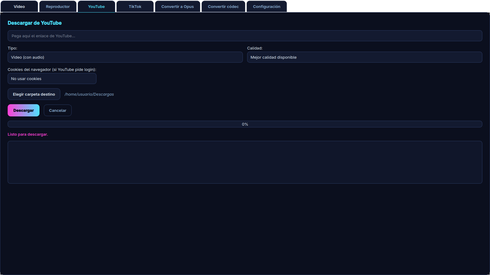
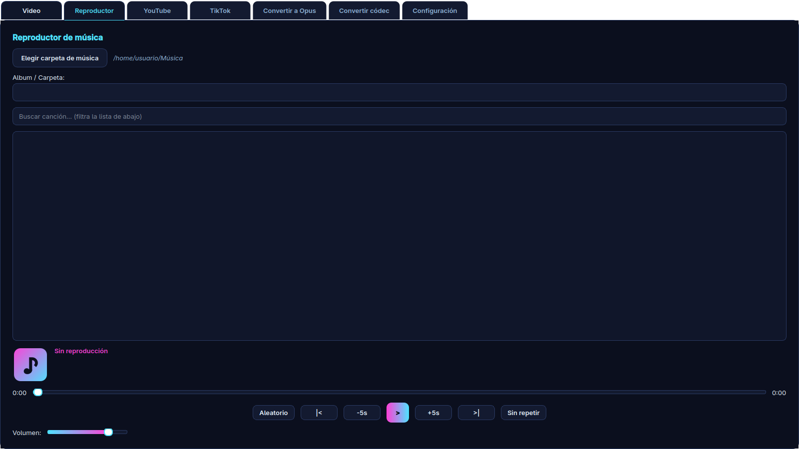
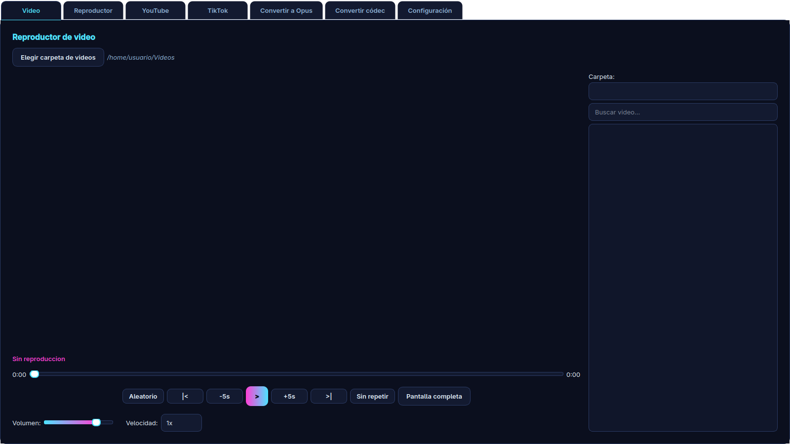
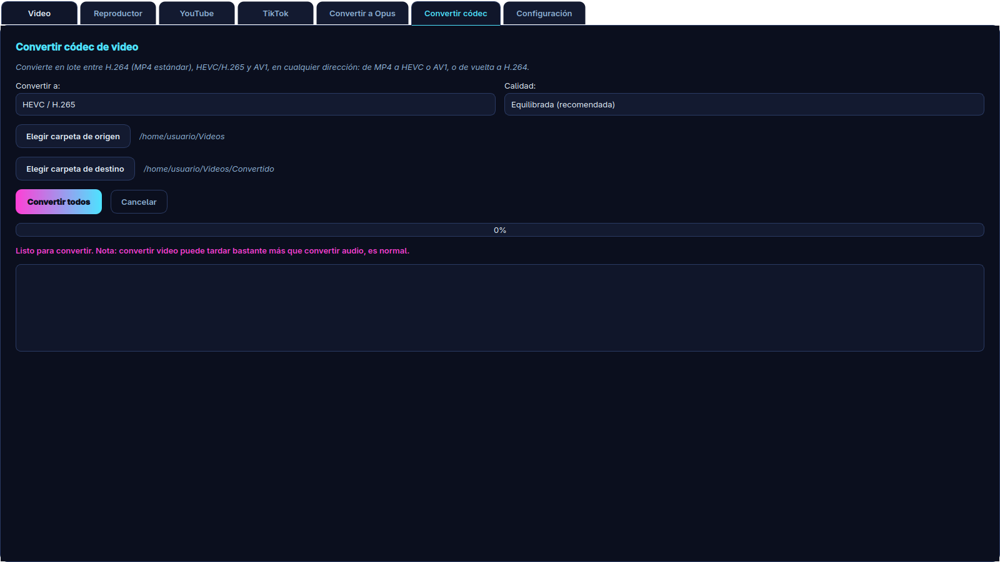
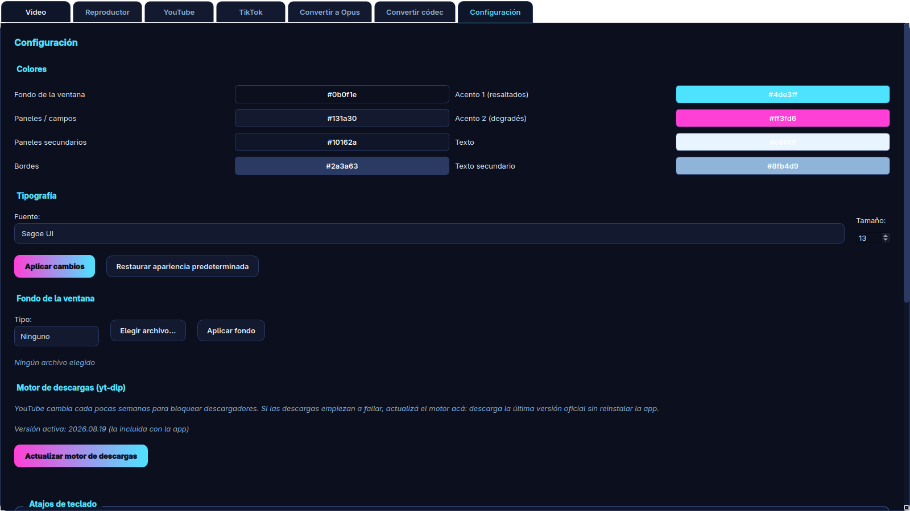

<p align="center">
  
</p>

<h1 align="center">Laguna Media</h1>

<p align="center">
  <strong>Descargá de YouTube y TikTok, convertí audio y video, y reproducí tu biblioteca.<br/>
  Todo en una sola aplicación, para Linux, Windows y Android.</strong>
</p>

<p align="center">
  <a href="../../releases/latest"></a>
  <a href="../../releases"></a>
  
  <a href="LICENSE"></a>
  
</p>

<p align="center">
  <a href="../../releases/latest"></a>
  <a href="CHANGELOG.md"></a>
</p>

---

> **Este repositorio es informativo.** Acá **no está el código fuente**: publica
> la documentación del producto y los **binarios compilados** en
> [Releases](../../releases/latest). Laguna Media es software **propietario**;
> ver [Licencia](#licencia).

---

## Tabla de contenido

- [Qué es Laguna Media](#qué-es-laguna-media)
- [Capturas de pantalla](#capturas-de-pantalla)
- [Descargas](#descargas)
- [Instalación](#instalación)
- [Primeros pasos](#primeros-pasos)
- [Qué puede hacer](#qué-puede-hacer)
- [Cómo funciona](#cómo-funciona)
- [Qué versión elegir](#qué-versión-elegir)
- [Rendimiento](#rendimiento)
- [Solución de problemas](#solución-de-problemas)
- [Historia: los errores que atravesamos](#historia-los-errores-que-atravesamos)
- [Preguntas frecuentes](#preguntas-frecuentes)
- [Privacidad y transparencia](#privacidad-y-transparencia)
- [Control de calidad](#control-de-calidad)
- [Cambios de la versión 3.0.3](#cambios-de-la-versión-303)
- [Licencia](#licencia)
- [Autor](#autor)
- [Aviso legal](#aviso-legal)

---

## Qué es Laguna Media

Hacer lo que esta app hace exigía **cuatro o cinco programas distintos**: uno
para bajar el video de YouTube, otro para la música, un navegador con extensión
para TikTok, un editor para pasar los audios a Opus, un conversor aparte para
cambiar de códec y el reproductor del sistema para escuchar el resultado.

Laguna Media unifica todo eso en una sola ventana:

| Función | Qué hace |
|---|---|
| **Descargar** | Videos y audio de **YouTube** y **TikTok**, hasta 4K/2160p, o sólo la pista de audio (MP3, Opus, M4A, FLAC, WAV) con bitrate seleccionable |
| **Convertir** | Audio y video entre formatos: MP3, Opus, M4A, FLAC, WAV, OGG, MP4 (H.264 / HEVC / AV1), MKV, WebM. Incluye *remux* sin recomprimir |
| **Reproducir** | Reproductor de música y de video con biblioteca local, miniaturas, carátulas y caché |
| **Personalizar** | Tema oscuro "neón" armado desde ocho colores y una tipografía, 27 atajos reasignables |
| **Auto-repararse** | Cuando YouTube cambia algo y las descargas dejan de funcionar, la app **actualiza su propio motor** sin reinstalar nada |

---

## Capturas de pantalla

| Descargar de YouTube | Descargar de TikTok |
|---|---|
|  |  |

| Reproductor de música | Reproductor de video |
|---|---|
|  |  |

| Conversión de códec | Configuración y personalización |
|---|---|
|  |  |

*Capturas de la app real, con rutas de ejemplo (la biblioteca aparece vacía a propósito).*

---

## Descargas

Todos los binarios de la última versión están en
**[Releases → última versión](../../releases/latest)**.

| Archivo | Plataforma | Requisitos |
|---|---|---|
| [`LagunaMedia-x86_64.AppImage`](../../releases/latest/download/LagunaMedia-x86_64.AppImage) | Linux x86_64 | glibc 2.35+ (Fedora 36+, Ubuntu 22.04+, Debian 12+) |
| [`LagunaMedia-portable-win64.zip`](../../releases/latest/download/LagunaMedia-portable-win64.zip) | Windows 10 / 11 x64 | Ninguno (portable, sin instalador) |
| [`LagunaMedia-Android.apk`](../../releases/latest/download/LagunaMedia-Android.apk) | Android 7.0+ (API 24), cualquier arquitectura | ~212 MB de espacio libre |
| [`SHA256SUMS.txt`](../../releases/latest/download/SHA256SUMS.txt) | — | Huellas SHA-256 para verificar la descarga |

El APK está **firmado con la clave de release** (no es un build de debug), así
que las actualizaciones se instalan encima de la versión anterior, y soporta
páginas de memoria de **16 KB**, el requisito de los Android más nuevos.

**Verificar la descarga** (Linux):

```bash
sha256sum -c SHA256SUMS.txt
```

¿Buscás la versión liviana, sólo para descargar y convertir? Está en su propio
repositorio: **[Laguna Media Lite](https://github.com/JonathanDevHurtado/LagunaMedia-Lite)**.

---

## Instalación

### Linux — AppImage

Un único archivo que ya trae todo: no se instala, no toca el sistema y se borra
cuando quieras.

```bash
chmod +x LagunaMedia-x86_64.AppImage
./LagunaMedia-x86_64.AppImage
```

Si la distribución no tiene FUSE habilitado:

```bash
./LagunaMedia-x86_64.AppImage --appimage-extract-and-run
```

### Windows — portable

1. Descomprimí el `.zip` en la carpeta que quieras (por ejemplo `C:\LagunaMedia`).
2. Ejecutá `lagunamedia.exe`.

No hay instalador ni entradas en el registro: se desinstala borrando la carpeta.
Si SmartScreen avisa que el programa no está firmado, es normal en software
independiente (*Más información → Ejecutar de todas formas*); podés verificar el
SHA-256 antes de ejecutarlo.

### Android — APK

1. Pasá el `.apk` al teléfono (cable USB, nube o mensajería) y abrilo desde el
   explorador de archivos.
2. Cuando Android lo pida, permití **instalar apps de orígenes desconocidos**
   para esa app (explorador o navegador).
3. La primera vez, Laguna Media prepara su motor (descomprime Python, yt-dlp,
   FFmpeg y aria2c): puede tardar unos segundos. Después arranca al instante.

También podés instalarlo por cable:

```bash
adb install -r LagunaMedia-Android.apk
```

**Notas de Android**

- Es un APK **universal**: incluye `arm64-v8a`, `armeabi-v7a`, `x86` y `x86_64`,
  por eso pesa ~212 MB.
- Funciona desde **Android 7.0 (API 24)** hasta Android 16, con páginas de
  memoria de 16 KB y `targetSdk 35`.
- Está firmado con una clave de release estable: a partir de la 3.0.3 las
  actualizaciones se instalan encima sin desinstalar.
- La app pide permiso de **notificaciones** (Android 13+) para mostrar el
  progreso de las descargas en curso.
- Las descargas se guardan en **Películas y Música** (galería del sistema) o en
  una carpeta elegida con el selector de Android.

---

## Primeros pasos

### Escritorio

1. **Descargar**: pegá el link, elegí *Video con audio* o *Solo audio*, la
   calidad y la carpeta de destino.
2. **Convertir**: elegí archivos y formato de salida; se convierten en paralelo.
3. **Reproductor / Video**: elegí tu carpeta de música o de videos una sola vez
   y la biblioteca queda indexada (escaneo en segundo plano + caché).
4. **Configuración**: tema, atajos, carpeta de la biblioteca y **motor de
   descargas** (el botón que arregla las descargas cuando YouTube cambia).

### Android

1. **Descargar**: elegí la plataforma (**YouTube** o **TikTok**) y pegá el link
   en su campo. También podés usar *Compartir → Laguna Media* desde YouTube o
   TikTok: la app detecta la plataforma sola y abre el link cargado.
2. Elegí **video** (con calidad) o **sólo audio** (MP3, Opus, M4A, FLAC, WAV) y
   dónde guardar.
3. **Convertir**: elegí archivos del teléfono y el formato de salida.
4. Si algo no descarga, tocá **Actualizar motor** en la pantalla de descarga.

---

## Qué puede hacer

### Descargar (escritorio y Android)

- **YouTube y TikTok separados**: en escritorio son dos pestañas
  independientes; en Android, un selector de plataforma con un campo de link
  propio para cada una y validación por dominio. El link compartido desde otra
  app elige la plataforma automáticamente.
- **Video con audio** hasta 4K/2160p, según lo que ofrezca el video.
- **Sólo audio** en MP3, Opus, M4A, FLAC o WAV, con bitrate seleccionable.
- **8 fragmentos en paralelo** y uso automático de **aria2c** si está
  instalado (en Android, opcional desde *Opciones avanzadas*).
- **Servicio en primer plano** en Android: la descarga sigue aunque cambies de
  app, con notificación de progreso.
- **Cola de descargas**: varias a la vez, cada una con su progreso, cancelación
  y resultado. Al terminar podés abrir o compartir el archivo.

### Convertir

- **Audio**: MP3, Opus, M4A, FLAC, WAV, OGG.
- **Video**: MP4 (H.264), MKV (H.264), WebM (VP9), MP4 (HEVC/H.265) y
  MP4 (AV1 con `libsvtav1`, con fallback si el equipo no lo soporta).
- Conversión **en paralelo** y **sin recomprimir** lo que no hace falta
  (`-c:a copy`), con progreso real leído de FFmpeg.

### Reproductor (escritorio)

- Música y video con biblioteca local, miniaturas, carátulas y caché SQLite.
- Pantalla completa estilo VLC, 27 velocidades (0.1x–4x), control por frame y
  27 atajos reasignables.

---

## Cómo funciona

Laguna Media no reinventa la descarga de video: se apoya en dos herramientas
excelentes y les pone una interfaz cómoda, un flujo de conversión propio y un
sistema de actualización que mantiene todo funcionando con el tiempo.

```
        YouTube / TikTok
               │  (enlace)
               ▼
   ┌───────────────────────────┐
   │   Interfaz                │   Escritorio: Qt / PySide6 (QSS propio)
   │                           │   Android: Jetpack Compose + Material 3
   └─────────────┬─────────────┘
                 │  tarea (link + formato + destino)
                 ▼
   ┌───────────────────────────┐        ┌──────────────────────────┐
   │  Motor de descarga        │───────▶│  FFmpeg                  │
   │  yt-dlp  (actualizable)   │        │  mezcla, extrae, convierte│
   └─────────────┬─────────────┘        └────────────┬─────────────┘
                 │  archivo temporal                  │
                 └──────────────┬─────────────────────┘
                                ▼
                 Destino elegido: carpeta, galería del
                 sistema (MediaStore) o carpeta SAF
```

### El motor: yt-dlp, y por qué se actualiza solo

La descarga la hace **[yt-dlp](https://github.com/yt-dlp/yt-dlp)**, el
descargador de código abierto más mantenido que existe. El problema clásico de
cualquier app de este tipo es que YouTube cambia sus defensas cada tanto y la
copia que trae la aplicación queda obsoleta: las descargas empiezan a fallar con
errores raros y hay que esperar a que el desarrollador publique una versión
nueva.

Laguna Media rompe esa dependencia:

- **Escritorio**: el botón *Actualizar motor* baja la última versión oficial y la
  usa al instante, sin reinstalar.
- **Android**: además de ese botón, la app **se auto-repara**: antes de
  descargar, si el motor incluido tiene **45 días o más**, lo actualiza sola; y
  si una descarga falla por un cambio de YouTube, lo actualiza y **reintenta una
  vez** automáticamente.

### La conversión: FFmpeg con progreso real

Las conversiones las hace **FFmpeg**. Lo importante no es que convierta (eso lo
hacen todos), sino que **muestre progreso real**: la app lee la salida de
`ffmpeg -progress pipe:1`, así que la barra avanza según el trabajo que falta y
no según una estimación inventada. Además convierte **varios archivos a la
vez** y **no recomprime el audio** cuando no hace falta.

### Android: aplicación nativa, no un reempaquetado

La versión Android está escrita en **Kotlin con Jetpack Compose**. No es la app
de escritorio envuelta: es una aplicación nativa que usa
**[youtubedl-android](https://github.com/JunkFood02/youtubedl-android)** (el
mismo yt-dlp + ffmpeg + aria2c compilados como bibliotecas nativas) y un
**servicio en primer plano** con notificación de progreso, para que el sistema
no mate la descarga si cambiás de aplicación.

---

## Qué versión elegir

| | **Laguna Media** | **Laguna Media Lite** |
|---|---|---|
| Descargar YouTube / TikTok | ✅ | ✅ |
| Convertir audio y video | ✅ | ✅ |
| Reproductor de música y video | ✅ | ❌ |
| Conversión de códec (H.264/HEVC/AV1) | ✅ | ❌ |
| Biblioteca con miniaturas y caché | ✅ | ❌ |
| Temas y personalización | ✅ | ❌ (tema fijo) |
| Versión Android | ✅ | ❌ |
| Secciones | 7 (pestañas) | 3 (barra lateral) |
| Arranque | ~3 s | casi instantáneo |
| AppImage / Flatpak / Windows | 163 MB / — / 112 MB | 153 MB / 107 MB / 102 MB |

**Lite** existe para una sola cosa: bajar y convertir lo más rápido posible. Si
sólo querés eso, Lite es la indicada.

📦 **Laguna Media Lite tiene su propio repositorio con sus descargas:**
[github.com/JonathanDevHurtado/LagunaMedia-Lite](https://github.com/JonathanDevHurtado/LagunaMedia-Lite)

---

## Rendimiento

| Aspecto | Antes | Ahora |
|---|---|---|
| Arranque (escritorio) | ~10 s | **~3 s** (pestañas diferidas) |
| Biblioteca local | Escaneo completo en cada arranque | **Caché SQLite**: instantánea |
| Descarga | Un flujo por archivo | **8 fragmentos en paralelo**; con **aria2c**, 16 conexiones |
| Conversión por lotes | Archivo por archivo | **En paralelo** según núcleos de CPU |
| Progreso de conversión | Barra estimada | **Real** (`ffmpeg -progress pipe:1`) |
| AV1 | `libaom-av1` (lento) | **`libsvtav1`** con fallback automático |
| Android: primer arranque | — | Prepara el motor una vez y queda listo |

---

## Solución de problemas

### Los casos más comunes

**1. "YouTube ya no descarga" / `unable to extract` / `Some web client https formats … missing a url`**

YouTube cambió y el motor incluido quedó viejo (el binario se congela el día que
se compila). Solución:

- **Escritorio**: Configuración → **Motor de descargas** → *Actualizar motor*.
- **Android**: en la pantalla de descarga, **Actualizar motor**. En la 3.0.2 la
  app ya lo hace sola si el motor tiene 45 días o más, y también reintenta si
  detecta este tipo de error.

**2. El AppImage no abre en Fedora 41+ / Ubuntu 24.04+**

Esas distribuciones ya no traen `libfuse2`, que el AppImage necesita:

```bash
./LagunaMedia-x86_64.AppImage --appimage-extract-and-run
```

O usá **Laguna Media Lite**, que sí se publica como Flatpak.

**3. TikTok: `Your IP address is blocked from accessing this post`**

No es un fallo de la app: TikTok bloquea ese video para tu conexión (videos
viejos, restringidos por región o por el propio autor). Probá con otro video u
otra red.

### Tabla rápida

| Síntoma | Causa | Solución |
|---|---|---|
| `unable to extract` / deja de descargar | Motor (yt-dlp) viejo | **Actualizar motor** |
| `IP address is blocked` (TikTok) | El post está bloqueado por región | Probá otro video u otra conexión |
| "Ese link no es de YouTube / TikTok" | Plataforma equivocada o URL incompleta | Cambiá la plataforma o copiá el link del video |
| El video baja sin audio o sin video | El formato elegido no existe en ese video | Usá *Mejor calidad disponible* |
| AppImage: `GLIBC_2.xx not found` | Sistema más viejo que glibc 2.35 | Actualizá la distro o usá Lite (Flatpak) |
| AppImage no abre y no muestra nada | Falta FUSE | `--appimage-extract-and-run` |
| Se cierra al escribir o pegar un link (Linux) | Bug de 3.0.1 con `libxkbcommon` | Actualizá a **3.0.2** |
| Windows lo marca como desconocido | Binario sin firma comercial | Verificá el SHA-256 y ejecutá igual |
| Android no instala el APK | Orígenes desconocidos desactivado | Permitilo para el explorador/navegador |
| Android: la descarga se corta al cambiar de app | Servicio en primer plano detenido por el fabricante | Desactivá la optimización de batería para Laguna Media |
| Android: no aparece el archivo | Se guardó en la galería del sistema | Buscalo en *Películas y Música* o en la carpeta elegida |
| Descargas lentas | Una sola conexión | Instalá `aria2c` en escritorio; en Android activá *Descarga acelerada* |
| La conversión a AV1 es lenta | `libsvtav1` limitado por la CPU | Usá H.264 o HEVC para conversiones rápidas |

---

## Historia: los errores que atravesamos

Esta sección existe porque el proyecto se rompió varias veces de formas
interesantes, y cada rotura dejó una lección. Todo esto está arreglado.

| Síntoma | Causa real | Solución |
|---|---|---|
| **La app no abría en escritorio** (la ventana aparecía y desaparecía) | La ventana se creaba dentro del callback de un `QTimer` en una variable local: al terminar la función, Python la recolectaba y Qt cerraba la última ventana | `MainWindow` se crea de forma síncrona en `main()` y vive hasta que cerrás la app |
| **Android fallaba al descargar** aunque la app estuviera recién instalada | La detección de antigüedad del motor nunca funcionaba: `LocalDate.parse("2025.11.12")` falla porque yt-dlp versiona con **puntos** y no con guiones. El motor nunca se actualizaba y YouTube lo rechazaba (SABR) | Se parsea `aaaa.mm.dd` a mano; el motor se actualiza solo cada 45 días y se reintenta una vez tras un fallo típico de YouTube |
| **Links con `HTTPS://` en mayúsculas eran rechazados** | El teclado del teléfono escribe el esquema en mayúsculas y la normalización comparaba en minúsculas de forma sensible | El esquema se compara sin distinguir mayúsculas |
| **El error de una descarga no decía nada** | Se mostraba la última línea de la salida del motor, que suele ser un *warning*, y a veces quedaba vacía | Se prefiere la línea `ERROR:` y se traducen los casos frecuentes (video privado, bloqueo por región, 404) |
| **YouTube y TikTok dejaron de descargar** | Dos cosas a la vez: se usaba una opción que yt-dlp había descontinuado (`hls_prefer_native`) y la copia empaquetada del motor había quedado vieja | Se eliminó la opción obsoleta y se agregó el **actualizador del motor en la app** |
| **Conversiones "rotas", sin progreso** | El núcleo leía mal la salida de FFmpeg: el porcentaje quedaba en 0 % hasta terminar | Se reescribió para leer `ffmpeg -progress pipe:1` y mostrar progreso real |
| **La app se cerraba con error al salir** (*segmentation fault*) | Se mataban los hilos de trabajo con `QThread.terminate()`, que es *undefined behavior* | **Cancelación cooperativa**: se cancela la tarea, se mata el proceso de FFmpeg/yt-dlp y se espera a que terminen los hilos |
| **Crash al abrir Configuración** | Una pestaña recibía tres argumentos y su constructor aceptaba dos | Firma corregida |
| **Bucle infinito** al recorrer el layout | Se leía siempre el primer elemento (`itemAt(0)`) sin avanzar el índice | Iteración corregida |
| **"Abrir archivo" abría cualquier cosa** | Se usaba el widget real de una pestaña que todavía no se había cargado | Se resuelve la pestaña antes de usarla |
| **La biblioteca no detectaba archivos nuevos** | La caché comparaba contra una carpeta fija (`~/Música`) en lugar de la carpeta elegida | Se compara contra la carpeta configurada |
| **La versión Lite se quedó sin el arreglo del motor** | El código estaba duplicado en dos proyectos y una copia quedó vieja | Lite vive en el mismo repositorio y comparte el motor |
| **La app se congelaba al instalar en Fedora 41+** | El AppImage necesita `libfuse2`, que esas versiones ya no incluyen | Lite se publica también como **Flatpak** |

La lección general: **casi todos estos bugs venían de duplicar código o de
forzar el cierre de procesos**, no de la lógica del negocio. Las decisiones de
diseño salieron de ahí.

---

## Preguntas frecuentes

**YouTube dejó de descargar, ¿se rompió?**
No. YouTube cambia seguido. Usá **Actualizar motor** (escritorio: Configuración;
Android: pantalla de descarga). En Android, además, la app lo hace sola si el
motor tiene más de 45 días.

**¿Necesito cookies o iniciar sesión?**
En **Android no**: la opción de cookies se eliminó y la app funciona sin
configurar nada. En **escritorio** sigue disponible como opción avanzada
(elegís un navegador y la app lee sus cookies localmente) para contenido que
pide sesión; si no la usás, no hace falta tocar nada.

**TikTok no descarga.**
La causa más común es que TikTok bloquea ese video para tu conexión
(`IP address is blocked`) o que el link no es de un video. Probá con otro video
y verificá que hayas elegido la plataforma correcta.

**Las descargas van lentas.**
Instalá `aria2c` (`sudo dnf install aria2` / `sudo apt install aria2`): la app lo
detecta y baja con 16 conexiones. En Android, activá *Descarga acelerada*.

**El AppImage no abre.**
Puede ser FUSE o la versión de glibc. Probá
`./LagunaMedia-x86_64.AppImage --appimage-extract-and-run`. Si el problema es
glibc, tu distribución es más vieja que Ubuntu 22.04.

**¿Por qué el APK pesa ~240 MB?**
Porque incluye Python, yt-dlp, FFmpeg y aria2c compilados para las cuatro
arquitecturas de Android (arm64, armv7, x86, x86_64), para que funcione en
cualquier teléfono sin dependencias externas.

**¿Va a estar en Google Play?**
Por ahora no: se distribuye como APK directo desde Releases.

**¿Puedo usar la app para descargar contenido con derechos de autor?**
Ver el [Aviso legal](#aviso-legal). Es tu responsabilidad.

---

## Privacidad y transparencia

| Pregunta | Respuesta |
|---|---|
| ¿La app envía estadísticas de uso? | No. |
| ¿A qué servidores se conecta? | Sólo a YouTube/TikTok (para lo que le pedís) y a GitHub (para actualizar el motor, cuando corresponde). |
| ¿Dónde guarda la configuración? | En tu equipo: `~/.config/LagunaMedia/` (Linux), `%APPDATA%` (Windows) o los datos privados de la app (Android). |
| ¿Dónde guarda archivos temporales? | En la caché del sistema, y los borra al terminar cada tarea. |
| ¿Necesita mis contraseñas? | No. |
| ¿Requiere cuenta? | No. |
| ¿Hay comprobación automática de versiones? | No. |

---

## Control de calidad

- **Pipeline automático (CI)**: cada cambio compila los binarios de Linux,
  Windows y Android en máquinas limpias. Si algo no compila, no se publica.
- **Pruebas en dispositivo real**: las versiones de Android se prueban en un
  teléfono físico (instalación limpia, descarga de YouTube y TikTok y
  actualización del motor) antes de publicarse.
- **Checksums**: cada Release incluye `SHA256SUMS.txt` para comprobar que el
  archivo descargado es exactamente el que se publicó.
- **Versionado semántico**: `MAJOR.MINOR.PATCH`, con historial de cambios
  documentado versión por versión.
- **Sin telemetría ni rastreo**: nada que auditar.

---

## Cambios de la versión 3.0.3

- **Android: el APK publicado ya es un build de release firmado.** Antes era
  un build de debug (paquete `…app.debug`, firma de debug), lo que impedía
  actualizar la app sin desinstalarla. Ahora el paquete es
  `com.lagunamedia.app`, la firma es estable y las actualizaciones se instalan
  encima.
- **Compatibilidad con celulares nuevos**: se verificaron las páginas de
  memoria de 16 KB en todas las bibliotecas nativas y el APK pasa
  `zipalign -P 16`; probado con descarga real en Android 12 y Android 16
  (arm64).
- **Interfaz**: se quitaron los títulos duplicados ("Qué querés descargar",
  "Guardar en") y la repetición del destino debajo de los chips.
- **Mismo APK en el repo de Lite**: la versión Android ya tiene el alcance de
  [Laguna Media Lite](https://github.com/JonathanDevHurtado/LagunaMedia-Lite)
  (descargar y convertir, sin reproductor, biblioteca ni temas), así que el
  APK se publica en los dos repositorios en lugar de inventar dos variantes.

---

## Cambios de la versión 3.0.2

- **Corregido (Escritorio, Linux)**: la app se cerraba al escribir o pegar un
  texto (por ejemplo, un link) por una incompatibilidad de `libxkbcommon` entre
  el AppImage y el sistema. Ya está resuelto: se puede escribir y pegar con
  normalidad.
- **Corregido (Escritorio, Linux)**: las descargas fallaban con
  `CERTIFICATE_VERIFY_FAILED` porque el binario compilado en Ubuntu no
  encontraba los certificados del sistema en Fedora. Ahora usa su propio
  bundle de CA (`certifi`).
- **Corregido (Android)**: los errores de descarga ahora muestran el motivo real
  (video privado o eliminado, bloqueo por región de TikTok, link inválido,
  404) en lugar de una línea vacía o un *warning*.
- **Corregido (Android)**: si el mensaje de error quedara vacío, se muestra el
  tipo de error en vez de nada.
- Incluye todo lo de la [3.0.1](CHANGELOG.md#301--2026-10-20):
  auto-actualización del motor y links con `HTTPS://` en mayúsculas.

Ver [CHANGELOG.md](CHANGELOG.md) para el historial completo.

---

## Licencia

Laguna Media es **software propietario**. El código fuente no se distribuye y
los binarios se ofrecen para uso **personal y no comercial** conforme al archivo
[`LICENSE`](LICENSE). No se permite redistribuir, modificar, vender ni hacer
ingeniería inversa.

El software incorpora componentes de terceros que mantienen **sus propias
licencias**, y esta licencia no las restringe:

| Componente | Licencia | Uso |
|---|---|---|
| [FFmpeg](https://ffmpeg.org/legal.html) | GPL (build *gpl*) | Mezcla, extracción y conversión de audio/video |
| [PySide6 / Qt for Python](https://www.qt.io/licensing) | LGPL v3 | Interfaz de escritorio |
| [yt-dlp](https://github.com/yt-dlp/yt-dlp) | Unlicense (dominio público) | Motor de descarga |
| [youtubedl-android](https://github.com/JunkFood02/youtubedl-android) | GPL-3.0 | Motor de descarga en Android |

---

## Autor

**Jonathan Hurtado**

- GitHub: [@JonathanDevHurtado](https://github.com/JonathanDevHurtado)
- Correo: [JonathanHurtadoDev@proton.me](mailto:JonathanHurtadoDev@proton.me)

En el perfil de GitHub están publicados los demás repositorios del autor.

---

## Aviso legal

Laguna Media es una herramienta de uso personal. El autor **no** aloja,
distribuye ni promueve contenido con derechos de autor: la aplicación
únicamente permite descargar material al que el usuario tenga derecho de
acceso, y el uso que se le dé es responsabilidad exclusiva del usuario.

Descargar o redistribuir contenido protegido puede infringir los términos de
servicio de las plataformas y las leyes de propiedad intelectual de tu país.
Verificá siempre qué estás autorizado a descargar.

Este software se ofrece **"tal cual"**, sin garantía de ningún tipo.
